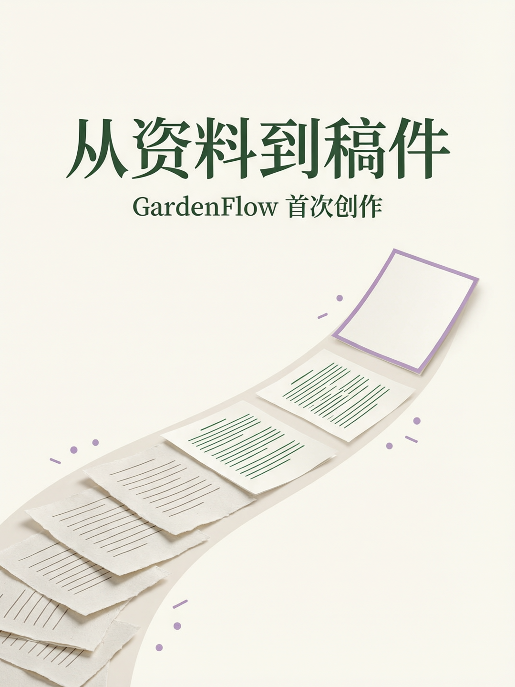

# GardenFlow 演示与示例

[首页](../README.md) · [首次创作教程](./FIRST_CREATION.md) · [商品创作与发布](./PRODUCT_CREATION.md)

本页展示实际界面和示例产物。截图中的商品、文案和工程用于演示功能；商品表述仍需在实际使用前核对。

## 从资料到介绍稿

这段 22 秒预览由实际输入、选题、人工核对稿和封面截图组成，模型等待已省略；它是截图切换，不是连续操作录屏，也不代表实际运行耗时。

可以按[首次创作教程](./FIRST_CREATION.md)复现，输入资料和分步提示词见[示例目录](../examples/first-creation/README.md)。文本创作需要自行配置模型，生成封面需要单独配置图片服务。

- [人工核对后的介绍稿](../examples/first-creation/output/gardenflow-intro.md)
- [3:4 示例封面](../examples/first-creation/output/gardenflow-first-creation-cover.png)

## 商品视频与套图

先选择商品的目标平台、形式、语言和规格，再发起规划：

套图工作台提供逐页预览、模板控件和工程编辑对话。示例封面使用 AI 画面，标题与正文仍是本地可编辑图层：

操作步骤和发布限制见[商品创作与发布](./PRODUCT_CREATION.md)。两张截图均来自实际验收界面，并获授权用于公开说明；截图中出现的测试文案不作为商品事实或推荐依据。

当前源码与较早安装包可能存在功能差异。支持范围和已知限制见[路线图](../ROADMAP.md)，构建方式见[安装包文档](./PACKAGING.md)。
