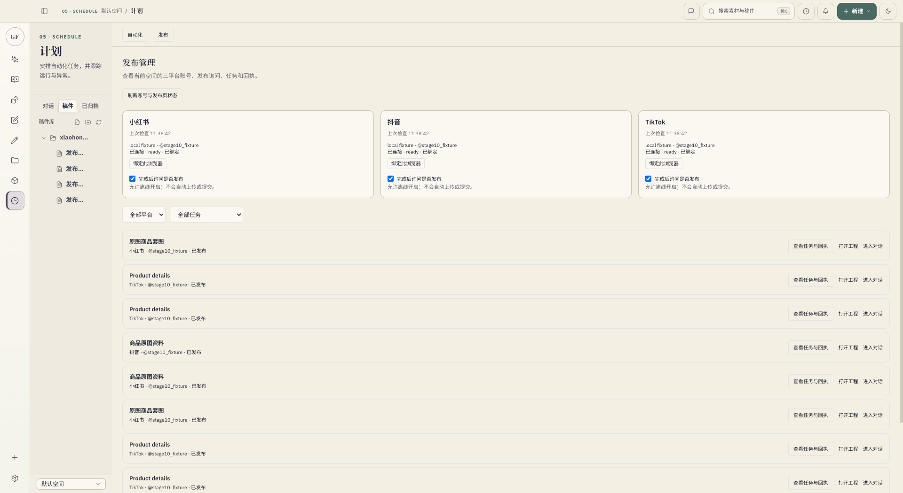
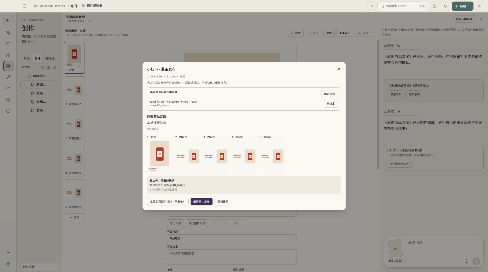
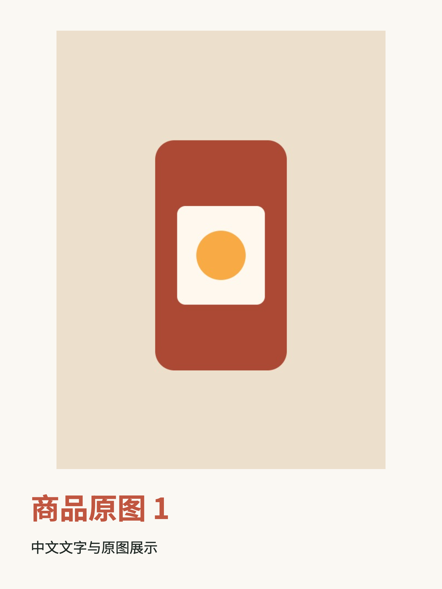

# 阶段 10：统一发布管理与完成后询问验收

更新：2026-10-13。基于 `e734280` 与当前阶段 8／9 工作区开发，保留既有未提交代码、路线图和验收文档。阶段 10 首版开发、回归、开发版与 macOS arm64 打包程序的隔离验收完成；真实平台验收单独留档。

## 实现范围

- 在“计划”页增加发布分区，展示三平台账号、绑定浏览器、插件连接、发布页状态、独立询问开关、当前空间任务与结果。可以筛选、打开工程、进入对应编辑对话和查看任务。
- 三平台商品视频（含已有片段混剪）及小红书套图共用“准备发布”。准备前复用手动输入保存；工程修订、未保存输入、目标绑定、正式文案、设置、媒体归属及摘要由主进程读取和校验。
- 准备只创建本地确认。上传按钮回读媒体、文案、账号与设置，并持久保存上传核验；第二个按钮才提交。自然语言、模型工具及直接服务调用不能替代按钮授权。更新了旧确认卡、兼容接口和发布技能规程。
- 小红书套图要求全部最新 PNG、封面首张、逐页顺序；重复内容复制为不同序号文件并串行上传。18 张是当前应用发布限制；19／20 张仍可编辑、导出，准备发布明确阻断，未截断或拆分。
- SQLite 保存发布快照、确认阶段、上传核验、完成事件与询问。语义摘要排除导出时间、路径和缓存 ID；相同内容不重复询问，暂不发布会保留决定。新内容再次完成可询问，单页 PNG、保存、失败及部分导出不触发。
- 小红书原开关保留；抖音／TikTok 默认关闭，三个开关允许离线启用。询问进入工程版本自己的编辑会话，不请求模型、上传或提交。关闭开关取消未提交的自动来源，手动来源独立；已有任务和询问中断可恢复。
- 编辑、账号／浏览器变化及页面草稿变化阻断旧确认。旧任务缺少核验时重新准备；历史账号不以当前账号回填。未知或审核中结果需明确核实，不自动重投；已提交／未知／已发布快照保持原值，缺少作品链接明确展示缺失。

抖音／TikTok 套图仍待适配。本轮没有定时、批量或免逐次确认发布。

## 检查结果

使用 Node.js 22.23.2、pnpm 10.28.2 与原锁文件，串行运行：

| 命令 | 结果 |
| --- | --- |
| `pnpm test` | 483 项通过，0 失败 |
| `pnpm check` | 源码／类型／技能检查通过；插件分组 28、24、6、29、83、129 项全通过 |
| `pnpm build` | 未签名 macOS arm64 `.app`、DMG、ZIP 构建通过 |
| `git diff --check` | 通过 |

新增核心回归位于 `desktop/tests/publicationManagement.test.ts`，覆盖四个支持组合、未支持组合、18／19／20 张、重复图片保序、损坏页面、目标／空间／账号／浏览器隔离、设置缺失、未保存输入、上传期间修改、失败回读重试、重复按钮、旧确认、原会话兼容、文案修改复用媒体、独立开关、暂不发布、语义去重、新内容询问、唯一编辑会话、中断投递及受保护历史。

发布插件新增 `PublishPlugin/tests/publicationReview.test.mjs`；本地 HTML 与真实插件生命周期验证唯一账号来源、串行图片、旧草稿保护、缺失核验、换账号、顺序／文字／清单变化及提交前阻断。既有三平台状态、未知提交和可信回执回归继续通过。

## 应用与 Chromium 隔离验收

`desktop/scripts/product-publication-electron-qa.cjs` 运行真实主进程、preload、renderer 与实际 PNG／MP4 渲染。使用同一隔离商品、本地原图和两个无音轨片段，开发版、打包程序各覆盖小红书视频、抖音视频、TikTok 视频、TikTok 混剪、小红书五张套图。

每个场景通过方案确认创建工程，进入绑定编辑会话，导出，收到完成询问，准备本地任务，确认上传并读取核验，单独点击最终按钮，展示模拟结果，修改文案并核对发布快照不变。直接跳过上传的最终提交被阻断；重复准备复用任务。两种程序均退出冷启动，核对工程数量、会话 ID、发布快照和历史恢复。

| 环境 | 场景 | 上传／提交 | 冷启动重投 | 图片／视频／语音模型 |
| --- | --- | --- | --- | --- |
| 开发版 | 5 | 本地模拟各 5 次 | 0／0 | 0／0／0 |
| macOS arm64 包 | 5 | 本地模拟各 5 次 | 0／0 | 0／0／0 |

8 个实际 MP4 均为 1080×1920、30fps；验收片段为 1 秒。容器有 AAC 流，解码 PCM 峰值为 0，确认静音。2 个 ZIP 各包含 5 张 1440×1920 PNG，封面与页序正确，包含文案和清单。套图中文与实际导出封面已目视检查，发布分区、缩略图及双确认状态已记录。

`desktop/scripts/publication-plugin-electron-qa.cjs` 另在 Chromium 的隔离会话执行真实插件代码与 CDP 文件选择、受信点击：HTTPS 请求被本地 HTML 协议处理截获；三张相同内容的图片分别上传并保留三个媒体锚点；换账号拒绝提交；恢复原测试账号后只点击一次，记录成功并恢复空白页。未连接任何真实平台或真实账号。

证据见 [证据目录](./evidence/publication-stage10/summary.json)、[产物检查](./evidence/publication-stage10/artifact-verification.json)、[Chromium 插件结果](./evidence/publication-stage10/chromium-publication-result.json)。首轮夹具错误保留在临时目录：模拟成功返回后未清理旧归属导致混剪被安全阻断；随后修正为返回空白页并重跑通过。截图采集增加 DOM／帧等待，证据采用复核后的记录。

## 未运行分支与限制

- 没有运行真实平台上传、最终提交、真实账号识别与实页适配验收；模拟结果不代表真实发布成功，需逐件作品、账号和动作获得用户确认后再测。
- 没有真实文本／图片／视频／语音模型调用。阶段 8／9 的真实模型质量和既有套图 AI、非静音混剪余项保持原结论。
- 验证的是打包 `.app` 可执行程序；没有新增 DMG 拖拽安装或签名／公证结论。
- 套图工作台读取既有稿件提案时，控制台仍出现未注册的 `manuscripts:get-write-proposal` 查询；本轮发布入口、编辑保存、导出与重开未受影响，普通稿件提案功能不计为本轮完整验收。

## 界面与产物

