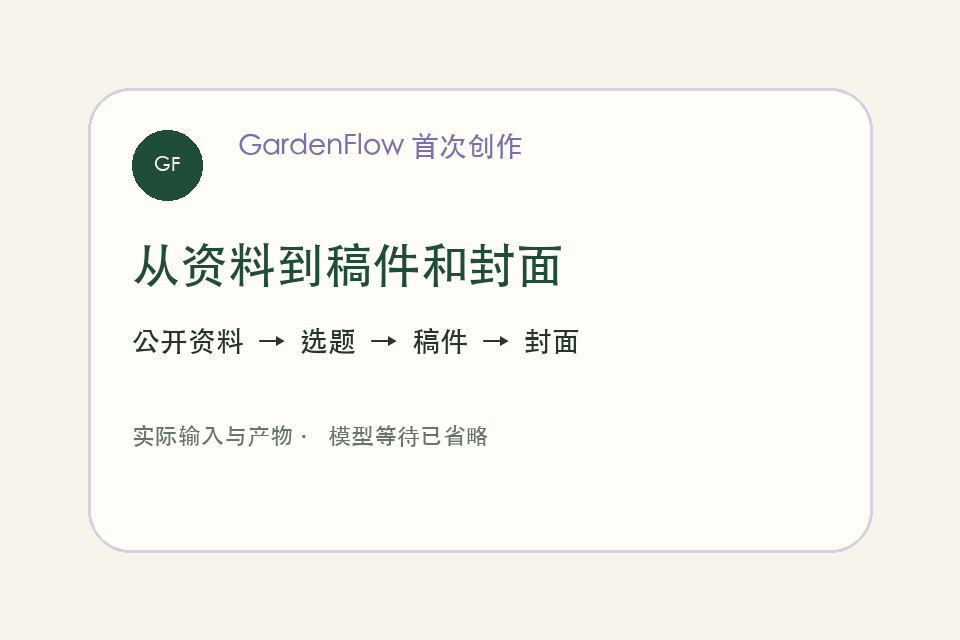
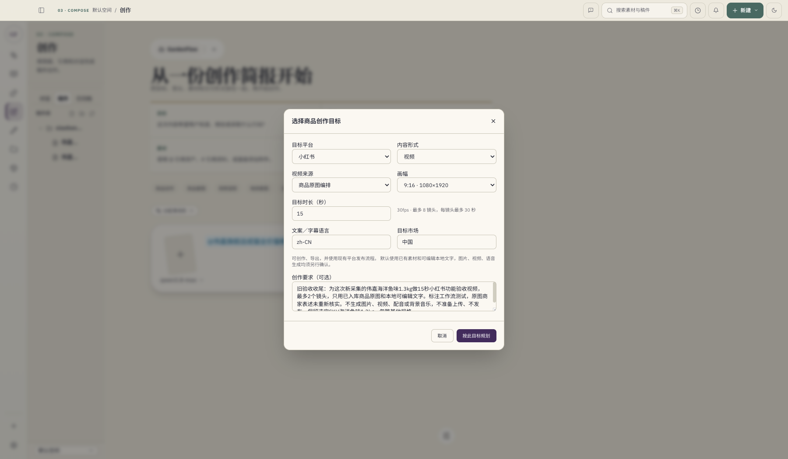
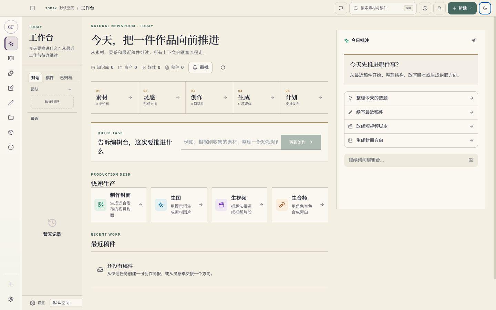
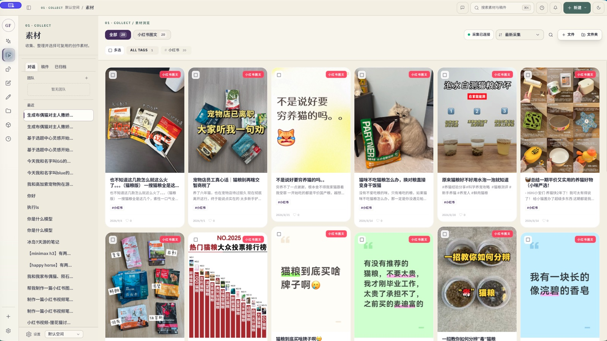
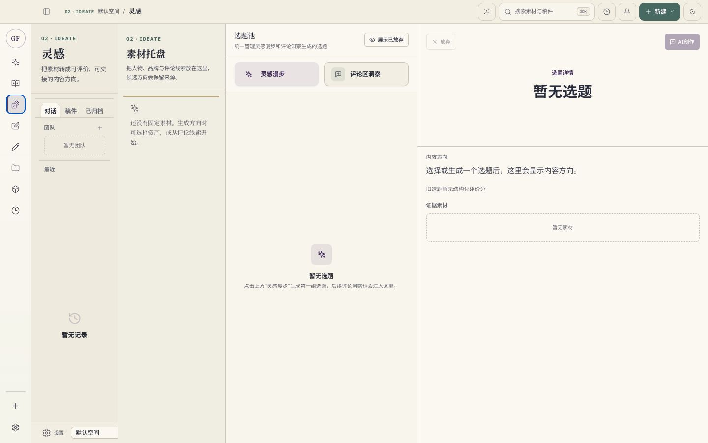
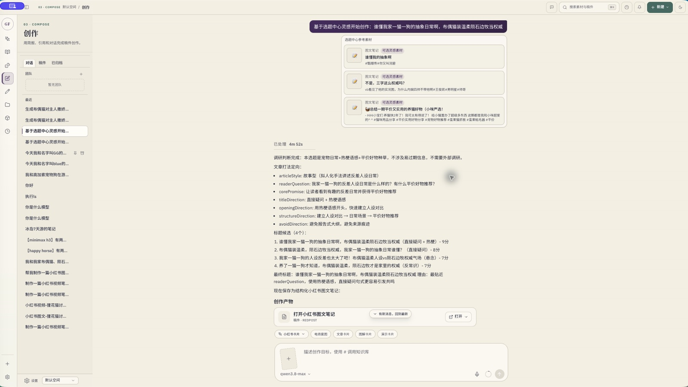
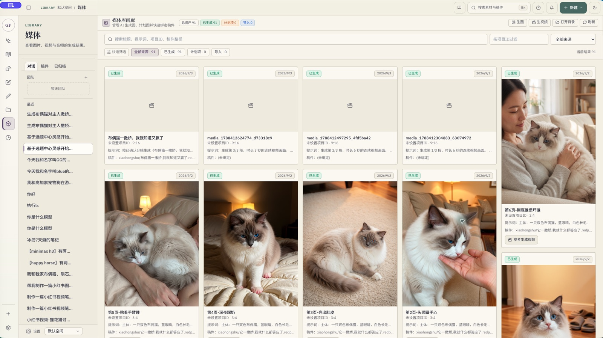
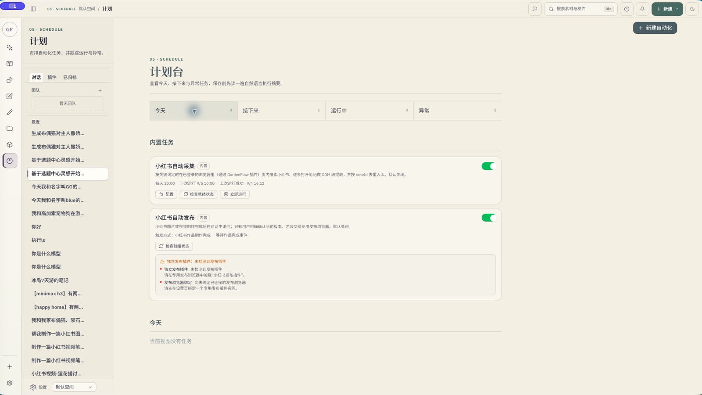
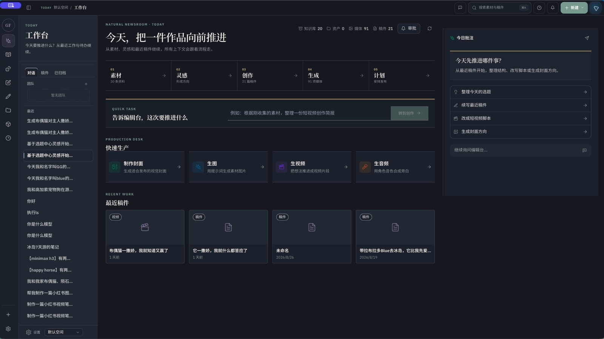

# GardenFlow

**把收集的资料，变成有来源的稿件和封面。**

GardenFlow 是本地优先的 AI 内容创作工作台，把素材、选题、AI 写作和媒体资产放在同一处。

[下载安装包](https://github.com/Garden12138/garden-flow/releases/latest) · [观看演示](./Docs/DEMO.md) · [首次体验](./Docs/FIRST_CREATION.md) · [English](./README_EN.md)

[](./Docs/DEMO.md)

- **从已有资料开始写**，保留来源与引用。
- **素材、会话、稿件和封面集中管理**，围绕同一空间组织。
- **自行选择模型服务**，工作空间保存在本机。

> [首次体验](./Docs/FIRST_CREATION.md)需要自行配置文本模型；封面需要单独配置图片服务。云端请求可能产生供应商费用。GardenFlow 采用[非商业 Source-Available 许可证](./LICENSE)，并非 OSI 认可的开源软件。

如果这个工作流对你有用，欢迎 Star 关注更新，或在 [Discussions](https://github.com/Garden12138/garden-flow/discussions) 分享使用反馈。

## 从一篇介绍稿开始

[用 GardenFlow 介绍 GardenFlow](./Docs/FIRST_CREATION.md)：下载公开示例资料 → 添加到知识库 → 选择角度 → 带来源写作并保存 → 可选生成封面。教程提供输入资料和分步提示词，先完成文字稿，再逐步启用其他能力。

## 从商品到视频与套图

选择已入库商品，先确定小红书、抖音或 TikTok 目标，再规划、确认并创建独立工程。在同一作品的编辑对话中连续修改，或手动调整镜头、页面与文案；导出后通过“准备发布 → 上传核对 → 最终确认”完成发布。

支持三平台视频、已有片段混剪和小红书套图。默认复用商品原图或已有片段，付费图片、视频和语音生成需另行确认；文本模型请求仍可能产生费用。详见[商品创作与发布](./Docs/PRODUCT_CREATION.md)。本节说明当前源码能力，较早安装包可能尚未包含全部入口。

| 创作前选择平台、形式与规格 | 逐页模板编辑与工程专用对话 |
| --- | --- |
|  |  |

这两张截图来自获授权的实际验收界面，商品和文案用于演示流程，商品表述仍需另行核对。

## 为什么选择 GardenFlow

- **从研究直接进入创作**：浏览器采集进入知识库，灵感池把证据和选题交给创作工作台。
- **把评论原文绑定到机会**：在[消费者机会](./Docs/CONTENT_OPPORTUNITIES.md)中整理支持与反例，采纳后进入既有作品；来源变化时检查关联内容，逐项记录人工复核决定。
- **让作品反馈进入下一轮**：在[内容观测与实验](./Docs/CONTENT_EXPERIMENTS.md)中导入真实指标，保留口径与限制；通过[成组内容](./Docs/CONTENT_CAMPAIGNS.md)组织不同职责的作品，逐项确认创作。
- **多媒体进入统一媒体库**：图片、视频、音频可继续用于封面、稿件和视频工程，能力范围取决于所配置模型。
- **自动化可见、可停、可复核**：计划任务、执行状态和产物在本地留档。
- **隐私边界清楚**：没有使用分析和自动诊断上传；外部 AI 请求按用户选择发送给对应供应商。

## 产品流程


## 产品界面

以下通用工作台截图来自同一个实际使用中的 GardenFlow 空间，展示已有素材、选题、稿件和媒体产物。



### 从采集素材到形成选题

| 浏览器采集后的素材库 | 带证据与评分的灵感桌 |
| --- | --- |
|  |  |

### 带引用、任务耗时与稿件结果的 AI 创作



### 统一媒体库与自动化计划

| 图片、视频与音频资产 | 定时任务与插件就绪诊断 |
| --- | --- |
|  |  |

深色模式保留相同的信息层级与操作密度：



## 能力矩阵

| 阶段 | 能力 | 主要产物 |
| --- | --- | --- |
| 采集 | Chrome/Edge/Brave 扩展、小红书结构化采集、通用网页正文提取、本地文件导入 | 网页快照、素材条目、引用来源 |
| 知识 | 文档索引、全文检索、向量检索、来源回看、空间隔离 | 可检索知识库 |
| 灵感 | 素材漫步、评论洞察、候选选题、证据绑定 | 选题与创作方向 |
| 创作 | 多会话 AI、引用上下文、任务时间线、结构化小红书稿件、封面工作台 | 文章、脚本、卡片、封面 |
| 商品作品 | 平台前置、原图视频、已有片段混剪、套图模板、持续对话编辑与独立平台版本 | MP4、PNG、图片目录、ZIP |
| 发布 | 计划页统一管理、账号与页面核验、上传核对与最终按钮确认 | 发布任务、回执与历史 |
| 生成 | 图片、视频、音频、语音、视频工程与字幕 | 媒体资产与工程文件 |
| 自动化 | 定时任务、内置采集任务、后台执行、审批与运行记录 | 可追踪任务和产物 |

具体能力取决于所配置供应商的协议和模型支持范围。

## 未来规划（待讨论）

以下是**待讨论的候选产品方向**，包含对已有能力的进一步拓展。具体实现范围、优先级和时间表尚未确定，可能调整、合并或取消，**不构成功能上线或交付承诺**。当前能力与已知限制请以本文的能力矩阵及[路线图](./ROADMAP.md)为准。

| 候选方向 | 希望解决的问题与探索内容 |
| --- | --- |
| 需求机会雷达 | 在已有评论洞察基础上，关联不同来源的受众问题、反例与变化，跟踪值得创作或进一步验证的机会。 |
| 从改稿中学习 | 从用户确认的修改中提取表达偏好，支持按品牌或账号限定范围、查看与撤销，减少重复纠正。 |
| 结果驱动的内容实验 | 在已有复盘基础上，将真实表现与账号、作品版本和观察周期关联，形成可追踪的下一轮假设与行动。 |
| 围绕目标的成组创作 | 围绕上新、活动或栏目规划一组承担不同任务的作品，共享事实和素材，减少逐篇重复规划。 |
| 持续研究与内容维护 | 关联来源、结论与作品，在资料更新后提示受影响的内容，辅助复核与修订。 |
| 专业知识交付 | 将用户自己的经验和资料组织为可持续维护的指南、培训内容与资料包，探索模块化内容、版本管理和多种交付形式。 |
| 消费者研究与产品改进 | 结合商品、规格和评价，比较使用障碍、未满足场景与购买顾虑，辅助选品研究、商品说明和产品方案改进。 |
| 跨市场本地化 | 在已有语言与平台版本能力上，探索当地场景、术语、单位和表达审校，保持商品事实一致。 |
| 系列栏目与连续故事 | 在已有故事和主体资产基础上，探索跨集角色、场景与剧情设定复用、连续性检查及栏目规划。 |
| AI 搜索可发现性 | 探索自有知识在 AI 搜索中的引用表现、内容缺口与来源维护，帮助内容被找到和正确引用；不承诺排名或引用结果。 |

欢迎在 [Discussions](https://github.com/Garden12138/garden-flow/discussions) 分享具体使用场景、现有流程的痛点，以及最希望优先验证的方向。

## 快速开始

### 下载安装包

前往 [GitHub Releases](https://github.com/Garden12138/garden-flow/releases/latest) 下载与系统和架构匹配的公开安装包：macOS 提供 Apple Silicon（arm64）和 Intel（x64）DMG，Windows 提供 x64 安装程序，Linux 提供 x64 AppImage 与 deb。

当前公开安装包未进行 Apple 公证或 Windows 代码签名，首次启动时系统可能显示安全提示。GardenFlow 采用非商业 Source-Available 许可证，并非 OSI 认可的开源软件；下载安装即表示使用者应遵守本仓库的 [LICENSE](./LICENSE)。

安装后从[首次创作教程](./Docs/FIRST_CREATION.md)开始。普通用户不需要 Node.js 或 pnpm；网页采集扩展可以从应用内准备和导出。

### 源码开发环境


- Node.js 22
- pnpm 10.28.2
- macOS、Windows 或 Linux；打包目标以 `desktop/package.json` 为准
- 原生依赖构建工具。macOS 可执行 `xcode-select --install`

### 源码运行

```bash
git clone https://github.com/Garden12138/garden-flow.git
cd garden-flow
corepack enable
pnpm run setup
pnpm dev
```

首次启动会创建当前 GardenFlow 数据目录、`gardenflow.db` 和默认空间。随后打开“设置 → AI 供应商”添加供应商并选择能力路由；视频服务单独配置。

根目录的 `pnpm install` 只安装根目录依赖，首次安装或依赖变更后请使用 `pnpm run setup`。开发版与安装版共享数据目录和单实例锁；运行 `pnpm dev` 前请完全退出已有 GardenFlow（macOS 使用 `⌘Q`，仅关闭窗口不会退出应用）。已有实例运行时，新启动会激活现有窗口并正常退出，终端会显示原因。

### 常用命令

| 命令 | 用途 |
| --- | --- |
| `pnpm run setup` | 按锁文件安装根目录、两个扩展和桌面端依赖 |
| `pnpm dev` | 准备本地运行时并启动 Vite + Electron |
| `pnpm check` | 品牌、文档、接口、类型和扩展检查 |
| `pnpm test` | 运行桌面端 Node.js 测试 |
| `pnpm build` | 构建当前平台的无签名桌面安装包 |
| `pnpm build:plugin` | 构建采集扩展与发布扩展 |

## 配置 AI 供应商

GardenFlow 不提供共享密钥或默认云端网关。新安装的 AI 路由为 `disabled`；保存有效供应商并选择模型后才会启用。

| 类型 | 适合场景 | 必填项 |
| --- | --- | --- |
| OpenAI | 文本、视觉、图片等 OpenAI API 能力 | API Key、模型；自定义代理时填写 Endpoint |
| Anthropic | Claude 文本与视觉 | API Key、模型 |
| Gemini | Gemini 文本与多模态 | API Key、模型 |
| 本地服务 | Ollama、LM Studio、vLLM、LocalAI 等 | Endpoint、模型；允许空 Key |
| 自定义 | OpenAI-compatible 或项目支持的原生协议 | 协议、Endpoint、Key、模型 |

视频预设为 `aliyun-bailian`、`minimax`、`new-api-aliyun`、`new-api-minimax` 或 `custom`。两类 `new-api` 预设必须显式选择并填写 Endpoint、Key 和模型，GardenFlow 不会根据 URL 或模型名猜测上游。

完整说明见 [AI 供应商配置](./Docs/AI_PROVIDERS.md)。

## 浏览器扩展

安装包用户：在“设置 → 隐私与诊断 → 浏览器插件”点击“准备插件”，再点“打开插件目录”。应用会导出扩展并安装或修复 Native Messaging Host。

在 Chrome、Edge 或 Brave 的扩展管理页开启开发者模式，选择“加载已解压的扩展程序”并加载导出的目录。保持 GardenFlow 打开，检查知识库中的插件连接状态。“已准备”不代表浏览器已连接。详见[首次体验中的插件步骤](./Docs/FIRST_CREATION.md#需要采集网页时再装扩展)。

开发者从源码构建时使用：

```bash
pnpm build:plugin
```

采集扩展构建目录为 `Plugin/dist/extension/`，Native Host 仍通过应用的插件准备流程安装。

扩展只把用户明确采集的内容传给本机 GardenFlow；诊断最多在浏览器本地保存 40 条脱敏记录，仅在用户点击导出时生成报告。详见 [浏览器扩展说明](./Plugin/README.md)。

## 架构摘要

```text
React renderer
      │ typed bridge / IPC
Electron main ── AI runtime / tools / automation
      │                    │
SQLite + workspace         └── user-configured providers
      │
Native Messaging ── browser extensions
```

- `desktop/src/`：React、TypeScript、TailwindCSS renderer。
- `desktop/electron/`：Electron 主进程、SQLite、AI runtime、工具、媒体和自动化服务。
- `Plugin/`：内容采集与浏览器控制扩展。
- `PublishPlugin/`：小红书、抖音和国际版 TikTok 发布辅助扩展。
- `desktop/src/vendor/freecut/`：带独立归属声明的 FreeCut 工程能力。

深入了解见[架构文档](./Docs/ARCHITECTURE.md)。

## 数据与隐私

- 数据库：当前用户数据目录中的 `gardenflow.db`。
- 工作空间：用户选择的目录；默认内部目录为 `.gardenflow`。
- API Key：保存在本地应用设置中，仅发送给用户选择的供应商。
- 诊断：本地有界记录，导出时剔除 Cookie、Token、密钥、网页正文、Data URI 和绝对路径。
- 网络：核心功能可离线管理资料；AI、网页采集、模型下载和发布功能按操作访问相应第三方服务。

## 文档

- [首次创作教程](./Docs/FIRST_CREATION.md)
- [演示与示例](./Docs/DEMO.md)
- [商品创作与发布](./Docs/PRODUCT_CREATION.md)
- [路线图](./ROADMAP.md)
- [文档导航](./Docs/README.md)
- [使用手册](./Docs/USER_MANUAL.md)
- [本地开发与部署](./Docs/LOCAL_DEPLOYMENT.md)
- [AI 供应商配置](./Docs/AI_PROVIDERS.md)
- [测试与验收](./Docs/TESTING.md)
- [安装包构建](./Docs/PACKAGING.md)
- [贡献指南](./CONTRIBUTING.md)
- [安全策略](./SECURITY.md)

## 参与贡献

使用提问与作品分享请到 [Discussions](https://github.com/Garden12138/garden-flow/discussions)，可复现缺陷和功能建议请用 [Issues](https://github.com/Garden12138/garden-flow/issues)。开始贡献前请阅读 [CONTRIBUTING.md](./CONTRIBUTING.md)、[路线图](./ROADMAP.md)和 [CODE_OF_CONDUCT.md](./CODE_OF_CONDUCT.md)。安全问题请按 [SECURITY.md](./SECURITY.md) 私下报告，不要公开披露密钥或个人数据。

## 许可证

Copyright © Garden12138。

本仓库按 [GardenFlow Source-Available License (Non-Commercial)](./LICENSE) 提供，允许非商业使用、学习、修改和分发，商业使用需要事先书面授权。商业授权请通过仓库所有者的 GitHub 联系方式沟通。

第三方依赖与 vendored 代码继续适用其各自许可证；详见[浏览器扩展第三方声明](./Plugin/src/THIRD_PARTY_NOTICES.txt)、[FreeCut 归属声明](./desktop/src/vendor/freecut/ATTRIBUTION.md)和依赖声明。
